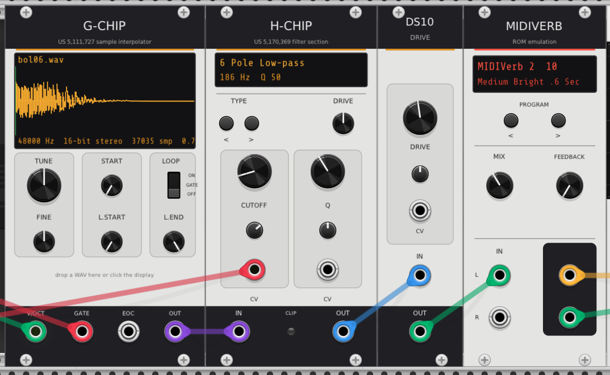

# emu-vcvrack: E-mu chips as VCV Rack modules

These are some of modules I never got around writing. Everything slopped to the last bit. The
E-mu filter is actually simulation of the internal structure of the ASIC (path-widths and
saturation points mostly guessed).



<br>

A VCV Rack 2 plugin with seven modules: the H-chip filter, the G-chip sample interpolator as a
sampler, a small drive, a 7-track CV/gate recorder, the Alesis MIDIverb ROM emulator, Filter
Lab, a filter you program in an editor on the panel, and Headroom, a paired gain up / gain down. **H-Chip Filter** is the digital filter section of E-mu's
patent US 5,170,369 (Rossum, "Dynamic digital IIR audio filter"), the filter block of the
Emulator IV's H-chip, run cycle by cycle, and programmed with the filter recipes of the EOS
firmware. Thirty of the E4's filter types are available: the stock lowpass, highpass, bandpass,
swept EQ, phaser, flanger and vocal types, and the OB-Xa and Fuzz types.

The DSP is a C++ port of a Rust cycle-level emulator of the patent and is bit-exact against it
(`test/`). The filter recipes (`dsp/emu_filters.cpp`: the decompiled `computeFrames` of EOS
3.20e and the OB-Xa / Fuzz reference) are used only to turn (filter type, Q) into the ten control words of a voice.

## What is modelled

`dsp/hchip.hpp`, `dsp/hchip.cpp`:

- FIG. 6 datapath: adder, four muxes, two accumulators, delay memory latches, multiplier input
  latches, run from the reservation table as microcode (nine control words per section, twelve
  with the gain rows);
- FIG. 7 block floating point multiplier as a three-latch pipeline;
- FIG. 8 coefficient decoder with the difference-coded first coefficient and the code table
  recovered on the chip;
- the voice: three sections in series from the E4's ten words, cutoff and flags
  (as measured on the E4): normalised and unnormalised pole
  sections, zero sections, the gain word.

Widths are the emulator's defaults: 24-bit wrapping accumulator and input, 16-bit saturating
delay memory, 16-bit saturating multiplier operand, 16-bit coefficient mantissa, floor-truncated
product. The module itself defaults to a 20-bit accumulator (the input bus is as wide and
clamps to it); the bit-exact tests run at 24. The module's context menu offers the
alternatives the patent leaves open: a 24-bit accumulator, a 17- or 18-bit multiplier operand,
round-to-nearest products, a saturating accumulator. Patches saved before the accumulator option
load at 24 bits.

**Not ported:** the interpolator of FIGs. 9 to 12, which moves the interpolating variable x
toward a destination over 32 to 4096 samples. Here the cutoff control is turned straight into x:
a cutoff of c (0..255, continuous) gives x = c / 255 × 65535, so a cutoff byte lands exactly on
the chip's c × 0x0101 and values in between are the chip's own fine steps. The codes are
re-interpolated whenever x changes, as the coefficient math unit would.

**Not modelled:** the voice gain compensation the firmware applies outside the filter (the
`ret` value of the recipes), the sample path before and after the filter, and the morph filter
types (Dual EQ Morph, 2EQ+Lowpass Morph, 2EQMorph+Exprssn, Peak/Shelf Morph), which take six
more parameters than the module has controls for.

## The module

| Control | Function |
|---|---|
| TYPE | filter type: click the display (left or right button) for the list of types, step with the < and > buttons (wrapping around) or scroll over the display; also in the context menu. The display shows the E4 menu name |
| CUTOFF, CV, attenuverter | cutoff 0..255 as on the E4, with 32 steps per volt of CV (about one octave on the lowpass display law) |
| Q, CV, attenuverter | the second parameter, 0..127 (Q, Gain, Resonance, Body Size or Fuzz depending on the type), 10 V of CV for the full range |
| DRIVE | input level into the chip, −24 to +24 dB, compensated at the output; 5 V peak is 16-bit full scale at 0 dB |
| IN, OUT | audio, polyphonic (one chip voice per channel) |
| CLIP | lights for 150 ms when anything in the chip overflows: delay memory or multiplier operand saturated, accumulator wrapped (or saturated), product saturated, input clamped to the input bus |

The display's second line is what the E4 shows for the two parameters: the frequency of the
display law (`fil_freq`), the gain in dB for the EQ types, or the raw value. The frequency is
scaled by the engine sample rate over 48 kHz: the chip runs at the engine rate and its
coefficients do not know the clock, so at 96 kHz the same words sit one octave higher.

## DS10 Drive

A second, small module: a hard clipper whose drive also sets the dry/wet mix,

```
out = mix(in, clamp(in * drive * 4, -1, 1), drive),   mix(a, b, t) = a + (b - a) t
```

per sample (`dsp/ds10_drive.hpp`), with 5 V as the 1.0 of the formula. DRIVE knob 0..100 %,
CV input with attenuverter (10 V for the full range), drive clamped to 0..1, polyphonic.

## Headroom

One GAIN knob, -36..+36 dB, and two signal paths: IN 1 -> OUT 1 is gained by the knob's amount,
IN 2 -> OUT 2 is attenuated by the same amount. Patch a module between OUT 1 and IN 2 to drive it
harder (or softer) without changing the overall level. Polyphonic.

## G-Chip Sampler

A WAV sample player whose resampler is the interpolator of US 5,111,727 (Rossum, "Digital
sampling instrument for digital audio data"), the E-mu G-chip of the Emax II / Emulator III
generation, implemented from a specification of that interpolator and nothing else:

- one 223-point linear-phase FIR prototype at 32 sub-phases; the symmetric half (112 words plus
  a zero at address 112) is the coefficient ROM, Table 1 of the patent (`dsp/gchip_proto.inc`,
  generated from the spec's list);
- seven taps per output sample on `x[i-2 .. i+4]`, coefficient addresses `|(-80 + 32 n) - f_MS|`,
  each blended toward the next ROM word by the fine phase, normalised to a sum of 1;
- a phase accumulator with 32 fraction bits per voice.

`test/gchip_test.cpp` checks the table's checksums and symmetry, the seven coefficient vectors
and the resampling vector of the spec's section 7 to 1e-9, the sum and symmetry invariants over
4096 phases, and an alias floor of −77 dB for a sine shifted up by 2^(1/3) (the spec's figure for
an implementation without the fine blend is −43 dB). The output point of the interpolator is
`x(i + f + 0.5)`: at phase 0 the taps sit half a sample either side of the centre, as the spec's
section 5 says and its resampling vector confirms.

| Control | Function |
|---|---|
| display | the waveform with start (green) and loop (blue) markers and the play heads; click it to load a WAV. A WAV dropped on the module loads too |
| TUNE, FINE | ±24 semitones, ±100 cents, added to the V/OCT input; 0 V plays the file at its own rate |
| START | where a gate starts playback, as a fraction of the file |
| L.START, L.END, LOOP | loop points as fractions of the file (set from the file's `smpl` chunk when it has one) and the loop mode: OFF plays once, GATE loops while the gate is high and then plays on to the end, ON loops until the next gate |
| V/OCT, GATE | polyphonic; one voice per channel, retriggered on each rising edge |
| OUT, EOC | audio (16-bit full scale is 5 V) and a 1 ms trigger when a voice runs off the end |

Context menu: "Fixed-point datapath" switches to the spec's scalar form with 16-bit coefficients
(unity 2^14), an 8-bit blend weight and a 32-bit accumulator, the widths section 8 of the spec
measures as the knee; the default computes the same taps in double precision. Both paths play
the same 16-bit words: files are converted to 16-bit mono on load (channels averaged), and the
file's sample rate against the engine rate is part of the pitch ratio. A loop is read with
wrapped addresses, which stands in for the replicated guard samples the spec asks for, so loops
need no prepared files. The file path is stored in the patch, not the audio.

Not in the spec and not modelled: the filter family of section 12 (only one impulse response is
published), the volume and mix stages, the four-bank memory timing.

## minty-seq

A 7-track CV/gate step recorder (`dsp/mintyseq.hpp`, `src/MintySeq.cpp`). Each track is 4 bars
of sixteenths (64 steps) in two patterns, A and B; ten sets hold seven tracks each. One track is
selected; what arrives at the CV and GATE inputs is recorded onto its current pattern. The start
is quantised to the nearest sixteenth (a key pressed in the second half of a step lands on the
next one); the length, measured from that start, is quantised to quarters of a sixteenth: 25, 50,
75 or 100 % of a step, or whole steps (ties) plus such a fraction, at least a quarter and at most
the whole loop. A note written over earlier notes replaces what it covers and cuts the tail of a
note it interrupts.
The selected track also plays the live input through while a key is held, so you hear what you
record.

| Control | Function |
|---|---|
| BPM | the internal clock, 30 to 300, default 127; ignored while CLOCK is connected |
| CLOCK, RESET | external clock, one pulse per sixteenth, and a reset to bar 1 (the next pulse plays step 1); the period is measured so recording still quantises |
| PLAY | start (from bar 1) / stop; stopping also stops recording and closes the gates |
| REC | record on the selected track; starts the transport if it is stopped |
| CLEAR | clear the selected track's current pattern |
| SEL (per track) | select the track; the lane shows the pattern and the play head, click it to select too |
| A/B (per track) | which pattern the track plays, switched at once; lit for B |
| MUTE (per track) | silences the track's playback (gate low, CV held); the selected track still monitors the live input; saved in the patch |
| SET < > | one of ten sets of seven tracks; the A/B choice is part of the set |
| CV, GATE in | what to record |
| PLAY, REC, CLEAR in | triggers for the same three buttons, for MIDI or CV control |
| CV, GATE out × 7 | one pair per track; a new note right after another gets a 1 ms gate gap; the CV holds the last note's value after its gate ends (including a live note) |
| CLICK out | a metronome click (audio): white noise through a 2 kHz high-pass with an exponential decay, on every beat, louder and longer on the first beat of a bar |

Keyboard: while the mouse is over the module or after clicking it, Space starts and stops, Enter
records, Shift+Backspace (or Shift+Delete) clears, Up/Down select the track, Tab switches the
selected track's A/B, Left/Right change the set. These keys are outside Rack's computer-keyboard
MIDI map (letters, digits, brackets, punctuation), so that keyboard keeps playing notes, and
outside Rack's own module shortcuts (a plain Backspace still deletes the module). Everything is
saved in the patch: the sets, the A/B choices, the selected set and track. The transport starts
stopped.

## MidiVerb

A port of the JavaScript Alesis MIDIverb emulator of http://ibawizard.net/midiverb/ (the page's
inline script, not the C version it links to), with its three ROM images compiled in:

| Device | ROM file | Size | Programs |
|---|---|---|---|
| MIDIVerb | `roms/midiverb.rom` | 32768 bytes | 1 to 64 |
| MIDIFex | `roms/midifex.rom` | 16384 bytes | 1 to 64 |
| MIDIVerb 2 | `roms/midiverb2.rom` | 32768 bytes | 0 to 99 (programs 50 to 69 with LFO) |

The ROMs were downloaded from that page and are turned into C arrays by
`tools/gen_midiverb_roms.py` (`dsp/midiverb_roms.inc`). `dsp/midiverb.cpp` is a line-for-line
translation of the page's `Machine`: each sample the ROM program's 128 instructions run over a
16K-word DRAM (four operations: add half, load half, store and add half, store inverted and
load half; instruction 0 writes the input, 0x60 and 0x70 read the left and right outputs), the
MIDIVerb 2 LFO patches the program's address words every 8 samples, and the output feeds back
by the FEEDBACK amount. JavaScript's number semantics are kept (the accumulator is a double,
shifts and inversion go through int32, DRAM stores wrap to 16 bits).

The resampling is the page's, unchanged: both inputs go through its 4th-order IIR (`Filterx2`),
the machine runs on every second engine sample with its output held in between, and the held
output goes through a second `Filterx2`. So the machine runs at half the engine rate (24 kHz at
48 kHz), exactly as it runs at half the browser's audio rate on the page.

| Control | Function |
|---|---|
| display | device, program number and name; click for the device and program menu, scroll to step |
| < > | previous / next program, wrapping |
| MIX | the page's dry/wet slider, default 50 % |
| FEEDBACK | the page's feedback slider, default 0 |
| IN L, R | 5 V is 1.0 of the page's range; R is normalled to L |
| OUT L, R | the page's output mix |

Selecting a device or a program reloads the program and clears the DRAM, as the page does. The
page's "mute effect input" and "fill DRAM with random numbers" buttons are not carried over.

Verification: `test/midiverb_test.cpp` checks the ROM sizes and program tables, runs all 228
programs for one second of an impulse and a noise burst (finite, bounded, audible output), and
checks that reverb tails decay without feedback; the smoke test checks that the module produces
exactly the core's output. The bit-for-bit comparison against the original JavaScript is
prepared but needs the reference vectors, which come from running the page's own script in
Node:

```
curl -sL -o /tmp/midiverb.html http://ibawizard.net/midiverb/
make -C test midiverb-vectors MIDIVERB_HTML=/tmp/midiverb.html   # writes test/expected/midiverb.txt
make -C test midiverb                                             # then compares 13 cases bit for bit
```

`dsp/midiverb.cpp` is compiled without the SDK's `-funsafe-math-optimizations` (and without
contracted multiply-adds), so the plugin computes the same doubles as the test.

## Filter Lab

A 44 HP module with a code editor on the panel: write a filter in a small per-sample language
(fscript, `dsp/fscript.*`), and it compiles as you type and replaces the running filter without a
dropout (state variables with the same name carry over). Switch between models with the display
at the top: twelve factory models and any you add.

| Factory model | What it is |
|---|---|
| TPT SVF | Zavalishin / Cytomic trapezoidal SVF, LP > BP > HP morph, notch on OUT2, input drive |
| Moog Ladder | Huovilainen's nonlinear ladder, tanh per stage, 2× internal |
| ZDF Ladder | four TPT one-poles with the feedback loop solved, tanh at the loop input, bass compensation |
| Korg35 | Pirkle's virtual analog MS-20 lowpass, saturating loop |
| Chamberlin SVF | the 1985 digital SVF, 4× internal, soft-limited band path |
| RBJ Biquad | cookbook LP / HP / BP / notch / peaking EQ |
| Butterworth 24 | 4th order LP/HP from two biquads |
| One-Pole | the simplest TPT LP/HP, a starting point |
| Comb | feedback comb tuned as a pitch, ± feedback, damping |
| Formant | three bandpasses on vowel formants, A-E-I-O-U morph |
| Phaser | six allpasses swept by an LFO, feedback |
| Template | the language reference as comments |

| Control | Function |
|---|---|
| display | `<` / `>` step through the models, the name opens the list, the wheel scrolls; `*` marks an edited factory model, `[...]` a user model |
| CODE / RESP | what the screen shows: the editor or the frequency response |
| editor | the current model's code; the status line shows the compile error (the line is marked red) or `ok`, the op count and the oversampling |
| P1..P4, attenuverter, CV | `p1..p4` in the script: knob + CV × amount / 10 V, clamped to 0..1 and smoothed (2 ms). With `hz(p)` a full CV amount is 1 V/oct. The labels come from the script's `#p1`..`#p4` lines; the raw CV is also `cv1..cv4` |
| IN1..IN4 | `in` (or `in1`), `in2`, `in3`, `in4`; 5 V is 1.0 |
| OUT1..OUT4 | `out` (or `out1`), `out2`, `out3`, `out4`; 1.0 is 5 V, clamped to ±12 V |
| ERR (title band) | the code does not compile (the last good version keeps running) |
| RESET (title band) | a voice produced NaN or infinity and was reset, or a loop ran past its budget |

Every jack carries its fixed caption (IN1..IN4, OUT1..OUT4) above it and, below it, the name the
script gives it with `#in`..`#in4` and `#out`..`#out4` (also in the jack's tooltip).

RESP replaces the editor with the filter's magnitude response: an impulse goes into IN1 of a fresh
voice (through the oversampler, as in the module), and the spectrum of the 8192 samples that come
out is drawn for every output that is not silent, 20 Hz to half the sample rate, +24 to -72 dB.
It follows the knobs and the CVs of channel 1 and every recompile; the mouse reads the frequency
and each output's level. A nonlinear filter's response depends on the impulse's height: 1.0 (5 V)
by default, -20 or -40 dB from the context menu for the small-signal response. A model that
modulates itself (the Phaser's LFO) is shown as it is right after a reset.

Polyphonic: one voice of state per channel, up to 16, the channel count being the largest of the
inputs'. Context menu: model list, new model from the template, duplicate as a new model, revert
to factory code, delete a user model, load/save a model as a `.fs` text file (default folder
`<Rack user folder>/FilterLab`), screen (code or response), response impulse level, reset state, oversampling (off, 2×, 4×, 8×; the script then sees
the oversampled `sr`), compile as you type (off: Ctrl+Enter), editor font size. Edited factory
models, user models and these settings are saved in the patch.

Editor keys: arrows, Home (first non-blank, then column 0), End, PgUp/PgDn, Ctrl+Home/End, Shift
to select, double-click selects a word, Tab / Shift+Tab indent (the selected lines), Enter keeps
the indent (and adds one after `{`), Ctrl+/ toggles comments, Ctrl+Z / Ctrl+Y (Ctrl+Shift+Z)
undo / redo, Ctrl+C/X/V/A, Ctrl+Enter compile, Esc leaves the editor. While the editor has the
keyboard, Rack's shortcuts and the computer-keyboard MIDI are off.

### fscript

```
#name One-Pole LP/HP          // header lines label the panel: #name #p1..#p4 #in..#in4 #out..#out4
#p1 Cutoff
g = warp(hz(p1))              // every variable is per-voice state: kept between samples, starts at 0
v = (in - s) * g / (1 + g)
lp = v + s
s = lp + v
out = lp
out2 = in - lp
```

The script runs once per sample per channel (or `factor` times with oversampling).

- **Inputs** (read only): `in`, `in2`, `in3`, `in4` (`in1` is `in`), `p1..p4`, `cv1..cv4` (volts),
  `sr`, `dt` (= 1/sr), `ch` (channel index). **Outputs**: `out`, `out2`, `out3`, `out4` (`out1` is
  `out`). **Constants**: `pi`, `tau`, `e`.
- **Statements**: `x = expr` (also `+= -= *= /=`; semicolons optional), `if c { } else if c { } else { }`
  (braces optional for a single statement), `for i in a..b { }` (b excluded), `init { }` (runs on
  reset: load, edit of init values, sample rate or oversampling change).
- **Declarations** (top level): `buf d[4096]` a per-voice array (indices wrap, so `d[w - n]` is a
  delay line), `buf t = [1, 2, 3]` a table, `const n = 4` (folded at compile time),
  `fn sat(x, k) = tanh(x * k) / k` (single-expression functions, inlined).
- **Operators**: `+ - * / % ^` (`%` floored, `^` power, right associative), `< <= > >= == !=`,
  `&& || !`, `c ? a : b`.
- **Functions**: `sin cos tan asin acos atan sinh cosh tanh exp log log2 log10 sqrt abs sign floor
  ceil round fract pow atan2 min max clamp(x, lo, hi) mix(a, b, t) step(edge, x)`, and for
  filters `hz(p)` = 20 × 1000^p (0..1 to 20 Hz..20 kHz, 0.1 per octave), `warp(f)` = tan(π f / sr)
  with f clamped below 0.49 sr (the TPT integrator gain), `mtof(n)`, `vtof(v)` (0 V = C4),
  `db(x)`, `clip(x)`, `soft(x)` (cubic soft clip), `noise()` (uniform −1..1),
  `tap(buf, pos)` (linear interpolated, wrapping read), `len(buf)`.

On a live edit the new program starts from the old voices' values for every variable or buffer
of the same name and size, except variables assigned in `init` and table buffers, which take
their new values; "Reset filter state" starts everything from zero. Loops are limited to 65536
iterations per sample; a runaway loop lights RESET and outputs silence instead of hanging the
engine.

The compiler (`dsp/fscript.cpp`) parses to a syntax tree, folds constants and emits bytecode for
a stack machine over one flat array of doubles per voice; nothing is allocated on the audio
thread. Compilation runs on the UI thread, the compiled program and its prepared voices are
handed to the audio thread through an atomic pointer. Cost at 48 kHz per voice: 0.3 % of a core
for the one-pole, 1.2 to 3.8 % for the ladders, SVFs and the formant bank (x86-64, `-O3`).

## Build

```
# the Rack SDK, once (https://vcvrack.com/downloads)
unzip Rack-SDK-2.6.4-lin-x64.zip -d sdk/
make -j8            # plugin.so
make dist           # dist/EmuHChip-2.0.0-lin-x64.vcvplugin
make install        # copies it into ~/.local/share/Rack2/plugins-lin-x64/
```

`RACK_DIR` selects another SDK location.

## Tests

```
make -C test check    # dsp/hchip.cpp against test/expected/vectors.txt, the recipes, and the measured responses
make -C test ds10     # the DS10 drive formula
make -C test gchip    # the G-chip interpolator against the spec's vectors, the voice, the WAV reader
make -C test minty    # the sequencer core: quantised recording, ties, playback, clocks
make -C test midiverb # the MidiVerb port: tables, all programs, and the JavaScript vectors if present
make -C test fscript  # the Filter Lab language, every factory model (stability, responses), the oversampler, the response analysis
make -C test smoke    # the Rack module headless against the SDK's libRack.so (16 channels, every type, cost)
```

`test/expected/vectors.txt` holds fifteen cases (stock types at byte and arbitrary cutoffs,
alternative widths, flags 0x00, 0x40 and 0xC0) of 3000 samples each, written by the Rust
emulator; the C++ port must reproduce every sample and every saturation counter. The response
checks reproduce the emulator's measured responses (2 and 6 pole lowpass, 4th
order highpass at cutoff 128, Q 64).

## Layout

```
plugin.json, Makefile        the Rack plugin
src/plugin.cpp, plugin.hpp   plugin entry
src/HChipFilter.cpp          the filter module: voices, controls, display, context menu
src/DS10Drive.cpp            the drive module
src/GChip.cpp                the sampler module: loading, voices, waveform display
src/MintySeq.cpp             the recorder module: I/O, buttons, keys, displays, patch storage
src/MidiVerb.cpp             the MidiVerb module: program display and menu, mix, feedback
src/FilterLab.cpp            the Filter Lab module: code editor, response view, model selector, voices, patch storage
src/widgets.hpp              runtime panel labels shared by the modules
res/*.svg                    the panel graphics (labels are drawn at runtime)
dsp/hchip.hpp, hchip.cpp     the chip model
dsp/ds10_drive.hpp           the drive formula
dsp/gchip.hpp, gchip.cpp     the G-chip interpolator and playback voice; gchip_proto.inc is Table 1
dsp/wav.hpp, wav.cpp         RIFF/WAVE reader (PCM 8/16/24/32, float, smpl loop)
dsp/mintyseq.hpp             the recorder core: sets, patterns, quantised recording, clocks
dsp/midiverb.hpp, .cpp       the MidiVerb port; midiverb_roms.inc the ROMs (tools/gen_midiverb_roms.py)
roms/                        the MIDIVerb, MIDIFex and MIDIVerb 2 ROM images
dsp/emu_filters.hpp, .cpp    the EOS filter recipes
dsp/fscript.hpp, .cpp        the Filter Lab language: lexer, parser, compiler, bytecode VM
dsp/filterlab_presets.cpp    the factory filter models, in fscript
dsp/oversampler.hpp          polyphase windowed-sinc up/downsampler (1, 2, 4, 8x)
dsp/response.hpp             Filter Lab's response view: impulse response and FFT of a program
test/hchip_test.cpp          DSP tests; test/expected/vectors.txt the reference vectors
test/ds10_test.cpp           drive formula test
test/gchip_test.cpp          interpolator, voice and WAV reader tests
test/mintyseq_test.cpp       recorder core tests
test/midiverb_test.cpp       MidiVerb tests; test/midiverb_ref.js writes the JavaScript reference
test/fscript_test.cpp        language, factory model and oversampler tests
test/smoke/smoke.cpp         headless module test
```
